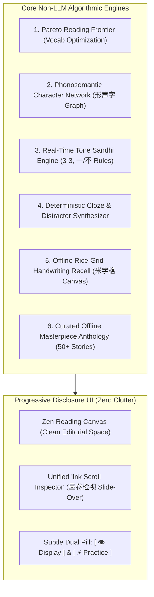

# Moyun (墨韵) — Offline-First & Zero-LLM Product Strategy

**Document Status:** Canonical Product & Architectural Blueprint  
**Target Milestone:** Offline & Zero-API-Key Feature Architecture  
**Author:** Antigravity Team  
**Focus:** Commercial viability without API keys, competitor benchmark gaps, non-LLM algorithmic engines, and progressive disclosure UI architecture to prevent cognitive overload.

---

## 1. Executive Summary & Product Thesis

### The "Sovereign Learner" Imperative
Most modern language learning concepts rush to wrap Large Language Models (LLMs) around basic reading tasks. While generative AI is impressive for dynamic story generation, relying exclusively on it as the primary product engine introduces severe commercial and pedagogical flaws:
1. **The Onboarding Chasm:** Over 90% of prospective language learners will bounce immediately if presented with an API key input modal (Gemini, OpenAI, Azure).
2. **Latency & Inconsistency:** LLM generation introduces 1.5 to 5 seconds of latency, breaking immersion during active study sessions.
3. **Connectivity Fragility:** Learners study most frequently during commutes (subways, flights, trains) where internet access is intermittent or non-existent.
4. **Pedagogical Drift:** LLMs frequently produce subtle grammatical hallucinations or violate strict HSK level vocabulary bounds, confusing elementary learners.

**The Moyun Thesis:**  
To be a world-class, commercial-grade product worth paying for, **Moyun must offer an extraordinary, comprehensive learning experience completely offline with zero API key requirement.** Generative LLM features should serve as an optional *creative multiplier*, never the baseline foundation.

### The Anti-Clutter Imperative (Combating "Feature Creep")
As features expand, applications naturally succumb to "interface bloat"—cluttering screens with floating action buttons, overlapping modals, and dense settings menus. 

Moyun's competitive advantage is its **calm, editorial, ink-wash aesthetic**. We must not make the interface "wider" by spamming buttons. Instead, we must employ **Progressive Disclosure**:
- The default state must always be a **zen-like, distraction-free reading canvas**.
- Advanced inspection must live in a **single, unified contextual drawer** rather than multiple disjointed modals.
- Tools must appear **only when relevant to the learner's immediate task**.

---

## 2. In-Depth Competitor Teardown & Benchmarks

We conducted an exhaustive audit of the leading Mandarin learning applications: **Pleco**, **Du Chinese**, **The Chairman's Bao (TCB)**, **Dong Chinese**, **Skritter**, **Hack Chinese**, and **Readibu**.

| Platform | Primary Strength (What they do best) | Critical Weakness (Where they fail) | Offline / Non-LLM Approach |
|---|---|---|---|
| **Pleco** | Industry-standard offline dictionary; deep radical index; instant clipboard lookups; one-time purchase model. | Utilitarian, outdated 2000s-era mobile UI; disconnected readers vs flashcards; zero native graded storytelling; desktop experience is non-existent. | 100% offline local SQLite dictionaries (CEDICT, Unihan, PLC). Zero LLM. |
| **Du Chinese** | Smooth, polished story reading; human audio sync; clean HSK tagging; excellent sentence translations. | Expensive ongoing subscription ($120/yr); cannot grade or analyze user-imported texts; no character component/etymology breakdown; purely passive reading. | Paid offline lesson downloads with human MP3 clips and timed sentence JSON. |
| **The Chairman's Bao (TCB)** | Real-world news rewritten for learners; strict HSK 1–6 tagging; live radio player. | Dry, clinical news topics; strict 11-lesson offline download limit; rigid comprehension quizzes; cluttered interface. | Downloadable offline news packs with audio and word lists. |
| **Dong Chinese** | Character decomposition; phonetic vs semantic component trees (形声字); frequency-first sequencing. | Fragmented reader experience; no long-form immersive narratives; clunky spaced repetition UI. | Algorithmic character relationship graphs and Subtlex-CH frequency statistics. |
| **Skritter** | Canvas stroke order recognition; active recall handwriting; stroke feedback. | Expensive ($15/mo) for a single interaction mode; isolated from holistic story reading; steep learning curve. | Algorithmic bezier stroke matching and SVG stroke vectors. |
| **Hack Chinese** | Automated curriculum curation; high-efficiency sentence-level SRS; zero-friction setup. | No reading theater; subscription-only; cannot import or read external literature; no handwriting practice. | Pre-indexed textbook vocabulary lists and SM-2 variation. |
| **Readibu** | Web novel reader with instant tap dictionary; free base tier. | Native web novels are far too difficult for HSK 1–4; zero vocabulary grading; ad-heavy interface. | Client-side tap lookup. |

---

## 3. "Blue Ocean" Opportunities: What Competitors Lack That Moyun Can Own (Zero LLM)

By leveraging our offline architecture (Vite + React 19 + TypeScript + IndexedDB + Web Audio + Canvas + Web Speech API), Moyun can build high-value, zero-LLM features that competitors either charge steep subscriptions for or fail to offer altogether:



---

### Feature 1: The "Pareto Reading Frontier" (Automated Vocabulary Yield Analyzer)
- **The Concept:** When a learner imports a book, article, or PDF, knowing *which* words to study first is overwhelming. The Pareto Reading Frontier algorithm analyzes character frequency across the entire ingested text against the user's known HSK level.
- **The User Value:** The reader displays a subtle, reassuring pill:  
  *"Learning these 5 specific characters will increase your comprehension of this entire story from 81% to 89%."*
- **Technical Implementation (Zero LLM):**  
  A deterministic frequency weighting algorithm that calculates `char_frequency_in_text * (1 - is_user_known)`. Takes 5ms to compute in memory. Ranks the top 5 highest-yield glyphs.

---

### Feature 2: The Phonosemantic Character Network (形声字 Sound-Meaning Graph)
- **The Concept:** Over 80% of Chinese characters are **phonosemantic compounds (形声字)**, composed of a semantic component (giving the meaning clue) and a phonetic component (giving the sound clue). Most apps treat Hanzi like random lines. Dong Chinese does this well in isolation, but no app links it seamlessly into a graded reader.
- **The User Value:** Tapping `清` (qīng - clear water) reveals:
  - **Semantic Radical:** `氵` (Water) ➔ Meaning category: liquid, wet.
  - **Phonetic Component:** `青` (qīng) ➔ Sound carrier!
  - **The Phonetic Family Tree:**  
    `晴` (qíng - sunny) | `情` (qíng - emotion) | `请` (qǐng - please) | `精` (jīng - spirit) | `清` (qīng - clear)
  - Learners experience an instantaneous "eureka!" moment: they suddenly recognize 5 characters for the price of 1!
- **Technical Implementation (Zero LLM):**  
  A lightweight static JSON graph mapping 2,500 common Hanzi to their phonetic stem and semantic radical. Loaded locally and queryable in sub-millisecond time.

---

### Feature 3: Real-Time Spoken Tone Sandhi Visualizer (3-3, 一 / 不 Rules)
- **The Concept:** Mandarin tones change in speech due to tone sandhi rules, but standard text and dictionaries always display citation tones:
  1. **3rd Tone Sandhi:** When two 3rd tones meet, the first becomes 2nd tone (`nǐ hǎo` ➔ spoken `ní hǎo`).
  2. **The "一" (yī) Rule:** 1st tone in counting, but 2nd tone (`yí`) before 4th tone (`一个` ➔ `yí gè`), and 4th tone (`yì`) before 1st/2nd/3rd tones (`一天` ➔ `yì tiān`).
  3. **The "不" (bù) Rule:** 4th tone normally, but 2nd tone (`bú`) before another 4th tone (`不是` ➔ `bú shì`).
- **The User Value:** Beginners get confused because native audio contradicts the printed Pinyin. Moyun's tone visualizer can display a subtle diacritic indicator showing the **actual spoken tone** vs the dictionary tone.
- **Technical Implementation (Zero LLM):**  
  A deterministic context-scanner that runs over segmented tokens applying the 3 classic phonetic rewrite rules. 100% offline, zero latency.

---

### Feature 4: Deterministic Cloze & Exercise Synthesizer (Instant Practice from Any Text)
- **The Concept:** Du Chinese and TCB lock exercises behind static, pre-written courses. Moyun can generate rich interactive quizzes from **any story** the user reads or imports—without touching an LLM.
- **Exercise Modes (All Algorithmic):**
  1. **Smart Cloze (Fill-in-the-Blank):** Blanks target words. Distractors are automatically selected from the same HSK level that share either the same radical or the same toneless Pinyin.
  2. **Sentence Jigsaw (Auditory Assembly):** Scrambles the tokens of a sentence. Plays sentence audio via Web Speech synthesis or pre-cached neural audio. Learner re-assembles the sentence.
  3. **Tone Triage:** Displays a word with 4 tone variants; user identifies the spoken tone contour.
  4. **Homophone Trap:** Questions testing commonly confused characters (在 vs 再, 的 vs 得 vs 地, 坐 vs 座).
- **Technical Implementation (Zero LLM):**  
  Extract sentence from story text, segment via `Intl.Segmenter`, pick target token, generate 3 distractors from in-memory `hanziDB.csv` matching level and part of speech.

---

### Feature 5: Offline Canvas "Blind Trace" Stroke Recall (The Skritter Killer)
- **The Concept:** Skritter charges $15/month for handwriting practice. Moyun already includes a calligraphic rice-grid (米字格) canvas with animated stroke orders. We can extend this with a zero-cost active recall mode.
- **The User Value:**
  - **Trace Mode (Beginner):** Faint gray watermarked strokes guide the finger/stylus.
  - **Blind Recall Mode (Advanced):** Blank rice grid. Learner draws stroke 1, canvas detects if direction and sequence match. If correct, stroke snaps into cinnabar red. If incorrect, subtle vibration and visual hint.
- **Technical Implementation (Zero LLM):**  
  Utilize existing `HanziWriter` / SVG stroke coordinate vectors already embedded in client-side bundles. Fully executable offline.

---

### Feature 6: Bundled "Masterpiece Anthology" (50+ Verified Offline Graded Stories)
- **The Concept:** When a user opens Moyun without an internet connection or API key, they shouldn't see an empty library. They should be greeted by a rich, curated anthology of graded Chinese literature.
- **Curated Content Anthology:**
  - **Level 1 (HSK 1):** Modern micro-dialogues (Ordering boba tea, finding the metro, greeting neighbors).
  - **Level 2 (HSK 2):** Adapted Aesop and world fables in accessible Mandarin.
  - **Level 3 (HSK 3):** Classic Chinese Idiom Stories (成语故事: 愚公移山, 亡羊补牢, 刻舟求剑, 滥竽充数).
  - **Level 4 (HSK 4):** Historical vignettes (Three Kingdoms legends, Journey to the West episodes).
  - **Level 5–6 (HSK 5+):** Contemporary cultural essays (tea ceremony, architecture, Beijing hutongs).
- **Technical Implementation:**  
  Stored locally as a structured JSON catalog in `src/assets/bundledStories.json` or pre-seeded into `libraryStore` on first boot. Complete with sentence-level English translations and HSK level tags.

---

## 4. Anti-Clutter UX & Information Architecture Blueprint

The user emphasized:  
> *"we need to be really careful about throwing too much information and too many features at the user at once... we should also be very careful of making the app simply wider, we should be considerate how much information we spam the user with and design our app/menus accordingly."*

To protect Moyun's editorial elegance while adding all of these capabilities, we adopt the following four design laws:

```
┌────────────────────────────────────────────────────────────────────────┐
│                   MOYUN EDITORIAL SCREEN ARCHITECTURE                   │
│                                                                        │
│   [ 墨韵 MOYUN ]   [Reading] [Speaking] [Islands] [Review] [Odyssey]   │
│                                                                        │
│   ┌──────────────────────────────────────────────┐ ┌────────────────┐ │
│   │                                              │ │  Ink Scroll    │ │
│   │             THE QUIET READING CANVAS         │ │  Inspector     │ │
│   │                                              │ │  (Drawer)      │ │
│   │   [ 👁️ Display ]              [ ⚡ Practice ] │ │                │ │
│   │                                              │ │  • Definition  │ │
│   │   这是北京的一家老茶馆。很多人在这里喝茶聊天。   │ │  • Phonoseman. │ │
│   │   今天天气晴朗，茶馆里坐满了客人。              │ │  • Stroke Grid │ │
│   │                                              │ │  • Sentence Ex │ │
│   │                                              │ │                │ │
│   │   [ ◀ Prev Sentence ]  [ ▶ Play ]  [ Next ▶ ] │ │  [+ Add SRS]  │ │
│   └──────────────────────────────────────────────┘ └────────────────┘ │
└────────────────────────────────────────────────────────────────────────┘
```

### 1. The "Quiet Reading Canvas" Principle
- The default reading view contains **zero sidebars, zero banner ads, and zero floating buttons**.
- Only the ink-wash header art, story title, clean typography, and a bottom audio scrubber exist.
- Learners are not bombarded with options until they explicitly ask for them.

### 2. Consolidated "Ink Scroll Inspector" (墨卷检视 Slide-Over Drawer)
- **Problem Today:** We have separate modals for `StrokeOrderModal`, `ConfusableModal`, `EtymologyModal`, and `CharacterTooltip`. Popping modal after modal breaks reading flow.
- **The Solution:** Replace fragmented dialogs with a single, sliding **"Ink Scroll Inspector" drawer** on the right side of the screen.
- When tapping any character or word, the drawer smoothly slides in without blocking the text:
  - **Tab 1: 释义 (Lexicon):** Word definition, Pinyin with tone color, HSK badge, audio pronunciation button.
  - **Tab 2: 剖析 (Anatomy):** Semantic radical breakdown + Phonetic sound family tree.
  - **Tab 3: 笔顺 (Calligraphy):** Interactive rice-grid drawing canvas with Trace/Recall toggle.
  - **Tab 4: 语境 (Corpus):** High-yield example sentence from the user's library.
  - **Primary Action (Floating Bottom Pill):** `[ ➕ Add to Flashcards ]`

### 3. Progressive Disclosure Toolbars (`Display` vs `Practice`)
- In the top action bar of the reader, consolidate all settings into two calm, text-labeled dropdown pills:
  1. **`[ 👁️ Display ]`**: Pinyin mode (Always/Hover/Hidden), Script (简/繁), Tone colors (On/Off), Font scale, Vertical reading mode.
  2. **`[ ⚡ Practice ]`**: Quick Cloze Drill, Sentence Jigsaw, Audio Pre-cache, Export to Anki/Pleco, Print/PDF.
- This reduces 10 scattered icon buttons down to 2 refined controls.

### 4. Zero-Friction Web Speech API Fallback
- For audio narration when no Azure key or internet is present, gracefully and silently fall back to `window.speechSynthesis` with client-side Chinese voices (`zh-CN`, `zh-TW`).
- Add an automatic voice-quality tester that benchmarks local browser voices and selects the highest-clarity voice available on Windows (e.g. "Microsoft Huihui", "Microsoft Yaoyao"), macOS/iOS ("Tingting", "Sinji"), or Android.

---

## 5. Non-LLM Feature Implementation Roadmap

We have structured the non-LLM feature additions into 6 concrete backlog tickets in [`docs/TICKETS.md`](file:///c:/Users/james/Documents/GitHub/mandarin-graded-reader/docs/TICKETS.md):

1. **`NONLLM-001`**: Bundled Masterpiece Anthology (50+ Offline Graded Stories with Verified Translations).
2. **`NONLLM-002`**: Phonosemantic Character Network (形声字 Semantic Radical & Phonetic Family Graph).
3. **`NONLLM-003`**: Pareto Reading Frontier (High-Yield Vocabulary Coverage Analyzer for Ingested Literature).
4. **`NONLLM-004`**: Real-Time Tone Sandhi Engine (3-3 Tone and 一/不 Spoken Phonetic Rules).
5. **`NONLLM-005`**: Algorithmic Cloze & Jigsaw Quiz Generator (Zero-LLM Practice from Any Story).
6. **`NONLLM-006`**: Unified "Ink Scroll Inspector" (墨卷检视 Consolidation of Stroke, Etymology & Homophone Modals).

---

## 6. Conclusion
By pairing **zero-LLM algorithmic superpowers** with **Progressive Disclosure UI design**, Moyun transforms from a promising prototype into a resilient, commercially competitive Mandarin learning platform. It empowers the learner on airplanes, subways, and off-grid retreats with instant responsiveness, deep linguistic insight, and an unhurried, calm reading experience.
